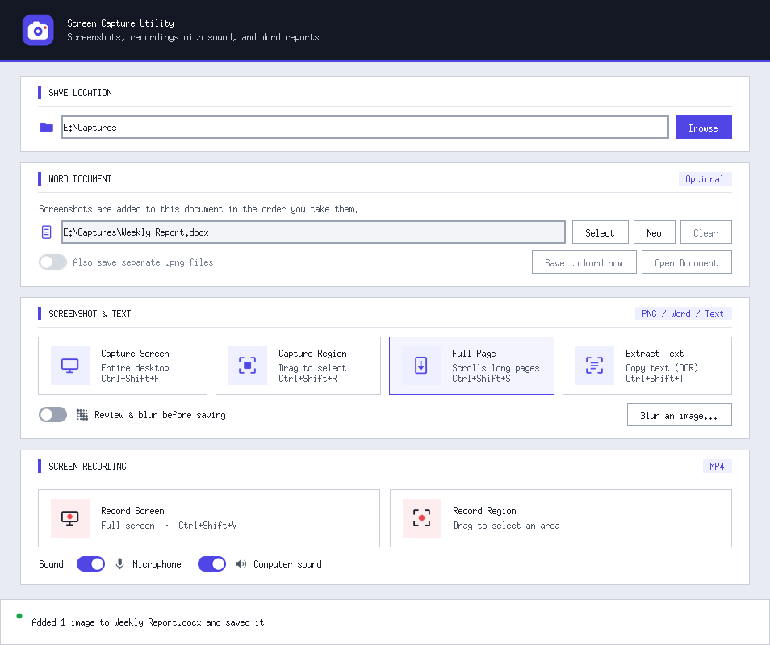
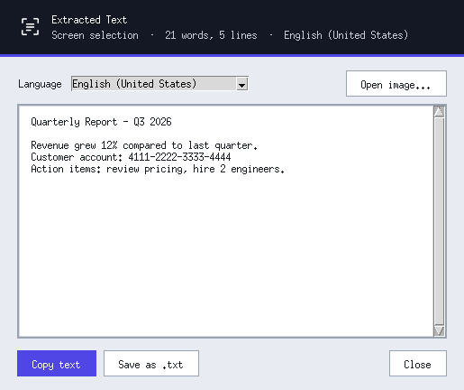
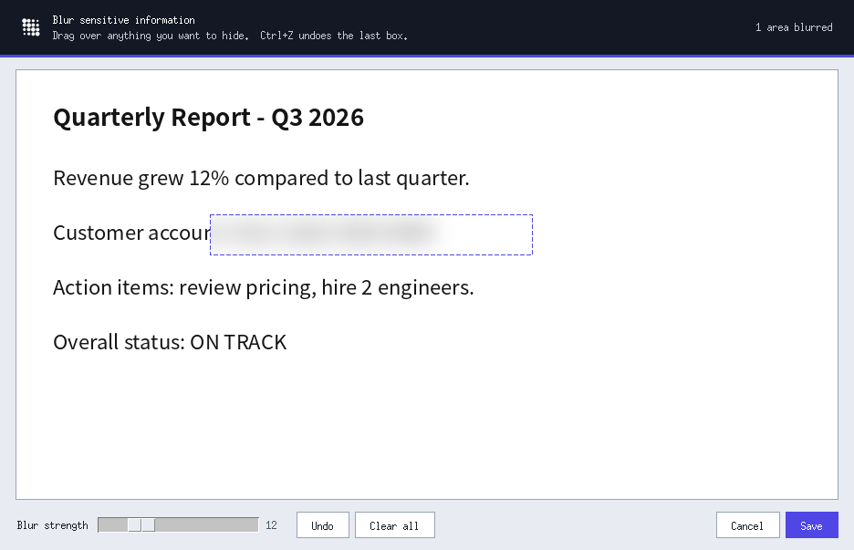
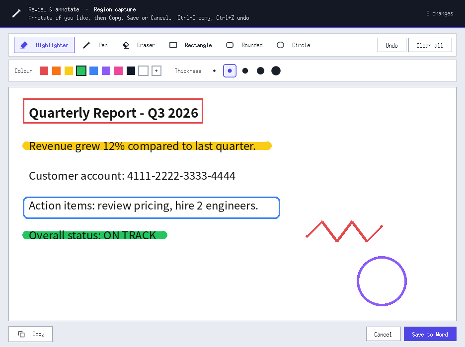
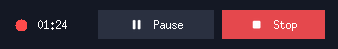

# Screen Capture Utility — User Manual

A Windows desktop tool for taking screenshots (whole screen, a region, or a full scrolling page), annotating and copying them, recording the screen with sound, extracting text from the screen, blurring sensitive information, and collecting everything into a Word document.

> Screenshots in this manual were taken on a test machine, so fonts look slightly different from Windows, where the app uses Segoe UI. Layout and buttons are the same.

---

## Contents

1. [Requirements](#1-requirements)
2. [Installing and starting the app](#2-installing-and-starting-the-app)
3. [The main window](#3-the-main-window)
4. [Save location](#4-save-location)
5. [Word document](#5-word-document)
6. [Screenshots](#6-screenshots)
   - [Capture Screen](#capture-screen)
   - [Capture Region](#capture-region)
   - [Full Page (scrolling capture)](#full-page-scrolling-capture)
   - [Extract Text (OCR)](#extract-text-ocr)
7. [Blur sensitive information](#7-blur-sensitive-information)
8. [Review window: annotate, copy, save](#8-review-window-annotate-copy-save)
9. [Screen recording](#9-screen-recording)
10. [Keyboard shortcuts](#10-keyboard-shortcuts)
11. [File names](#11-file-names)
12. [Building the .exe](#12-building-the-exe)
13. [Troubleshooting](#13-troubleshooting)

---

## 1. Requirements

| | |
|---|---|
| **Operating system** | Windows 10 or Windows 11 |
| **Python** (only when running from source) | Python 3.10 or newer |
| **For text extraction** | At least one language installed in Windows (normally already there) |
| **For hiding the recording controls from videos** | Windows 10 version 2004 or newer |

The Python packages the app needs are listed in `requirements.txt`:

| Package | Used for |
|---|---|
| `pillow` | Taking and editing screenshots |
| `python-docx` | Adding screenshots to Word documents |
| `imageio-ffmpeg` | Encoding recordings to MP4 and adding sound |
| `PyAudioWPatch` | Recording the microphone and the computer's sound |
| `winrt-*` packages | Windows' built-in OCR for **Extract Text** |
| `pyinstaller` | Building the `.exe` (only needed for `build.bat`) |

---

## 2. Installing and starting the app

### Option A — Run from source (Python)

1. Open PowerShell in the project folder, for example:
   ```powershell
   cd E:\ScreenCaptureUtility
   ```
2. (Recommended) Create and activate a virtual environment:
   ```powershell
   python -m venv venv
   .\venv\Scripts\Activate.ps1
   ```
3. Install the packages:
   ```powershell
   python -m pip install -r requirements.txt
   ```
4. Start the app:
   ```powershell
   python main.py
   ```

If you skip step 3, the app installs any missing packages by itself the first time it starts. This takes a minute or two.

**Start without a terminal window:** create a desktop shortcut with this target. Adjust the paths to your folder.
```
E:\ScreenCaptureUtility\venv\Scripts\pythonw.exe E:\ScreenCaptureUtility\main.py
```
Set **Start in** to `E:\ScreenCaptureUtility`, and pick `icon.ico` under **Change Icon**.

### Option B — Use the .exe

Run `dist\ScreenCaptureUtility.exe` (see [Building the .exe](#12-building-the-exe)). Python doesn't need to be installed. If Windows shows **"Windows protected your PC"**, click **More info → Run anyway**. This appears because the .exe isn't code-signed.

---

## 3. The main window



The window opens in the middle of the screen you're working on, and is made up of these sections:

| Section | What it's for |
|---|---|
| **Save location** | The folder where screenshots, recordings and text files are saved |
| **Word document** *(optional)* | A `.docx` that screenshots are added to automatically |
| **Screenshot & text** | Capture Screen, Capture Region, Full Page, Extract Text, and the blur option |
| **Screen recording** | Record the whole screen or a region, with sound |
| **Status bar** (bottom) | What just happened |

**Status bar colours:**
- 🟢 **Green:** saved successfully.
- 🟠 **Amber:** busy, or waiting (for example, the Word document is open in Word).
- 🔴 **Red:** something went wrong or was cancelled.
- 🔵 **Indigo:** information.

---

## 4. Save location

1. Click **Browse** and choose a folder, or type a path into the box.
2. If the folder doesn't exist, the app offers to create it.

If you start a capture without choosing a folder, the app asks you to pick one first. If you select a Word document before choosing a folder, the document's folder is used.

---

## 5. Word document

Collect screenshots straight into a Word document, in the order you take them.

| Button | What it does |
|---|---|
| **Select** | Pick an existing `.docx`. New screenshots are added **at the end**, after any existing content. |
| **New** | Create a new, empty `.docx`, with no heading, and use it. |
| **Clear** | Stop using the document. Screenshots go back to being saved as `.png` files. |
| **Also save separate .png files** | Also keep each screenshot as a `.png` in the save folder. |
| **Save to Word now** | Retry writing any screenshots that are waiting (see below). |
| **Open Document** | Open the document in Word. |

**How images are placed:**
- Screenshots are added oldest first, with **3 blank lines** between images.
- Each image is sized to fit the page width, but small images are never enlarged beyond their real size.
- Very tall images, such as full-page captures, are **split across pages** at full width so they stay readable.
- Only `.docx` files are supported. For an old `.doc` file, open it in Word and use **Save As → Word Document (.docx)**.

**If the document is open in Word:** Windows locks the file while Word has it open. Your screenshots are not lost:
- They **wait in a queue**, and the status bar says how many are waiting.
- They are added automatically, in order, a few seconds after you **close the document in Word**.
- If you close the app while screenshots are still waiting, it asks you to close the document and click **Retry**. Or choose **Cancel** to save them as `.png` files instead.

---

## 6. Screenshots

### Capture Screen
*Shortcut: **Ctrl+Shift+F***

Click **Capture Screen**. The app hides itself and captures the entire desktop (all monitors). The screenshot then opens in the [Review window](#8-review-window-annotate-copy-save), where you can annotate it, copy it or save it.

### Capture Region
*Shortcut: **Ctrl+Shift+R***

1. Click **Capture Region**. The screen dims.
2. **Drag** a rectangle around the area you want, then let go.
3. The area opens in the [Review window](#8-review-window-annotate-copy-save).

Press **Esc** to cancel.

### Full Page (scrolling capture)
*Shortcut: **Ctrl+Shift+S***

Captures a page that's longer than the screen, such as a long web page or a single-page application, as **one tall image**.

1. Open the page in your browser, or any app.
2. Click **Full Page**. The screen dims and shows a hint at the top.
3. **Drag over only the part that scrolls**, for example the web page content, starting below the browser's address bar and tabs. Including the scrollbar is fine.
4. Let go. The app scrolls the page **to the top**, then scrolls down step by step and stitches the screens together.
5. When it reaches the bottom, the tall image opens in the [Review window](#8-review-window-annotate-copy-save), like any other screenshot.

While it works, the app shrinks to a small progress bar:


- **Stop & Save**, or **Esc**, stops at any time and **keeps what has been captured so far**. It opens in the Review window.
- **Fixed headers and footers**, common in single-page apps, are detected and appear only once.
- **Small animations**, such as blinking cursors, spinners or clocks, are tolerated.
- **Safety limits:** 20,000 pixels tall, 80 scroll steps, or 3 minutes.

**Tips for the best result:**
- **Select only the content that actually scrolls.** A quick check: hover over the page and turn your mouse wheel. The part that moves is what you should select.
- **Leave out side menus.** The app scrolls at a point near the **right edge** of your selection, so that point must be over the scrolling content, not over a side menu.
- **Scrolling panels:** many single-page apps scroll an inner panel rather than the whole page. Select just that panel.
- **Moving content:** videos or rotating banners can cause small seams. Pause them first if you can.

### Extract Text (OCR)
*Shortcut: **Ctrl+Shift+T***

Copies text from anything on screen, even text you can't normally select, such as images, videos or locked PDFs. It uses the **OCR engine built into Windows**, so it works offline.

1. Click **Extract Text**.
2. **Drag** over the text.
3. The **Extracted Text** window opens, and the text is **already copied to your clipboard**.



In the Extracted Text window:

| Control | What it does |
|---|---|
| Text area | Edit the text if needed |
| **Copy text** | Copy the (edited) text again |
| **Save as .txt** | Save the text to a file |
| **Language** | Re-read the text in another installed Windows language |
| **Open image...** | Read text from an image file, such as a screenshot you saved earlier |

Small selections are enlarged automatically before reading, which improves accuracy, and paragraph breaks are kept.

---

## 7. Blur sensitive information

Hide passwords, account numbers, names and other sensitive details before a screenshot is saved.

**Blur every screenshot before saving:**
1. Turn on **Review & blur before saving**, in the Screenshot & text section.
2. Take a screenshot. The **Blur sensitive information** window opens.
3. **Drag a box** over each thing you want to hide. It is blurred immediately.
4. Click **Save**. The blurred screenshot then opens in the [Review window](#8-review-window-annotate-copy-save).



| Control | What it does |
|---|---|
| **Blur strength** (4–40) | How strong the blur is; it applies to all boxes |
| **Undo** / **Ctrl+Z** | Remove the last box |
| **Clear all** | Remove all boxes |
| **Save** / **Enter** | Save the screenshot |
| **Cancel** / **Esc** | Discard the screenshot (asks first if you blurred something) |

The dashed outlines only show you what's blurred. They are **not** saved in the image.

**Blur an existing image:** click **Blur an image...**, pick a file, blur it, and save. A copy named `<name>_blurred.png` is created, and the original isn't changed.

> **Tip:** For very sensitive data, make the box a little bigger than the text and use a strength of 20 or more. Light blur on large text can sometimes still be guessed.

---

## 8. Review window: annotate, copy, save

After **every** capture (Capture Screen, Capture Region and Full Page), the screenshot opens in the **Review & annotate** window. Nothing is saved until you choose to. If **Review & blur before saving** is on, the Blur window comes first.



**What you can do:**

| Button | What it does |
|---|---|
| **Copy** (or **Ctrl+C**) | Copies the screenshot, including your annotations, to the clipboard, so you can **paste it into Teams, Outlook, Word, Paint, etc.** with **Ctrl+V**. The window stays open, so you can still save afterwards. |
| **Save** / **Save to Word** (or **Enter**) | Saves to your folder, or adds it to your Word document if one is selected |
| **Cancel** (or **Esc**) | Closes without saving. If you copied first, the image stays on the clipboard. |

Annotating is optional; you can just click Copy or Save straight away.

**Annotation tools:**

| Tool | Key | How to use |
|---|---|---|
| **Highlighter** | H | Drag over text, like a real marker. The text stays dark and readable. |
| **Pen** | P | Draw or write freehand |
| **Eraser** | X | Drag over pen or highlighter marks to rub them out, fully or partly. Rectangles, circles and the screenshot itself are never erased. |
| **Rectangle** | R | Drag to draw a box |
| **Rounded** | U | Drag to draw a box with rounded corners |
| **Circle** | E | Drag to draw a circle or ellipse |

**Options:**
- **Colour:** nine preset colours, or **+** for any colour.
- **Thickness:** five sizes, shown as dots. The highlighter and eraser have their own, wider set of sizes. The eraser has no colour, so the colour row is hidden while it's selected.
- **Remembered settings:** each tool remembers its own colour and thickness, so the highlighter can stay yellow while the pen stays red.
- **Shift:** hold it while drawing a rectangle or circle for a **perfect square or circle**.
- **Undo / Clear:** **Undo** (Ctrl+Z) removes the last change, and **Clear all** removes everything.

**Quick recipes:**
- **Share in Teams or email without saving:** capture, then **Copy**, then **Cancel**. Paste it into the chat or email with **Ctrl+V**.
- **Save and share:** capture, then **Copy**, then **Save**.
- **Blur and annotate:** turn on **Review & blur before saving**. Each screenshot goes Blur window, then Review window, then Save.

---

## 9. Screen recording

Record the screen as an **MP4 video**, with sound from your **microphone** and/or your **computer's speakers**, such as a meeting or a video.

**Choose sound sources** with the switches in the Screen recording section:
- **Microphone:** what you say.
- **Computer sound:** everything the PC plays.

**Record the whole screen:** click **Record Screen**, or press **Ctrl+Shift+V**.

**Record part of the screen:** click **Record Region** and drag a rectangle.

While recording, the main window becomes a small control bar:



| Control | What it does |
|---|---|
| Blinking red dot + timer | Recording time (paused time not counted) |
| **Pause** / **Resume** (or **Ctrl+Shift+P**) | Pause and continue; paused time is left out of the video |
| **Stop** (or **Ctrl+Shift+V**, or the bar's **X**) | Stop and save the video |

**Keeping the bar out of the video:**
- On Windows 10 (version 2004 or newer) and Windows 11, the control bar is **hidden from the recording**, so it never appears in the video.
- For region recordings, the bar is also placed outside the selected area.

**After you stop:**
- The status bar shows "Saving recording… please wait" for a moment while the sound is combined with the video.
- It then shows the file name, the length, and which sound sources were recorded.

**Format:** H.264 video with AAC sound in an `.mp4` file, which plays in any player and in browsers. Sound and picture are kept in sync.

**Tips:**
- **Use headphones** when recording both microphone and computer sound. Otherwise the microphone picks up the speakers and you'll hear an echo.
- **Microphone not recorded?** Check **Windows Settings → Privacy & security → Microphone → "Let desktop apps access your microphone"**.
- **Wait for saving:** the app won't close until a recording has finished saving.

---

## 10. Keyboard shortcuts

These work while the Screen Capture Utility window is active.

| Shortcut | Action |
|---|---|
| **Ctrl+Shift+F** | Capture Screen |
| **Ctrl+Shift+R** | Capture Region |
| **Ctrl+Shift+S** | Full Page (scrolling capture) |
| **Ctrl+Shift+T** | Extract Text (OCR) |
| **Ctrl+Shift+V** | Start / stop full-screen recording |
| **Ctrl+Shift+P** | Pause / resume recording |
| **Esc** | Cancel a selection, or stop a Full Page capture (saves what was captured) |

In the **Blur** and **Review** windows:

| Shortcut | Action |
|---|---|
| **Ctrl+C** | Copy the screenshot to the clipboard (Review window) |
| **Ctrl+Z** | Undo |
| **Enter** | Save |
| **Esc** | Cancel |
| **H / P / X / R / U / E** | Review window tools: Highlighter / Pen / Eraser / Rectangle / Rounded / Circle |
| **Shift** (while drawing) | Perfect square / circle |

---

## 11. File names

Files are saved in the **Save location** folder. If two files would get the same name, `_2`, `_3`… is added.

| What | File name |
|---|---|
| Screenshot | `Screenshot_YYYY-MM-DD_HH-MM-SS.png` |
| Recording | `Recording_YYYY-MM-DD_HH-MM-SS.mp4` |
| Extracted text | `Text_YYYY-MM-DD_HH-MM-SS.txt` (you can rename it when saving) |
| Blurred copy of an image | `<original name>_blurred.png` |

---

## 12. Building the .exe

1. Make sure these files are in the project folder: `main.py`, `build.bat`, `requirements.txt`, and (optionally) `icon.ico`.
2. Open PowerShell in that folder and run:
   ```powershell
   .\build.bat
   ```
3. The script installs everything it needs, builds the app, and tells you where it is:
   ```
   dist\ScreenCaptureUtility.exe
   ```

That single `.exe` contains everything, including ffmpeg, the Word library, sound recording and OCR support, so you can copy it to any Windows 10/11 PC.

**Notes:**
- **Size and start time:** the .exe is fairly large (about 100 MB) and takes a few seconds to start, because it unpacks itself each time.
- **SmartScreen:** Windows may warn about it the first time; click **More info → Run anyway**.
- **Company policy:** some organisations block unsigned `.exe` files. In that case, run the app from source (see [Option A](#option-a--run-from-source-python)), or ask IT to approve or code-sign the `.exe`.

---

## 13. Troubleshooting

| Problem | What to do |
|---|---|
| **A feature button is greyed out / "unavailable"** | A package is missing. Run `python -m pip install -r requirements.txt`, or look at the terminal for the exact command. |
| **Screenshots aren't added to Word** | The document is probably open in Word. Close it and the waiting screenshots are added automatically, or click **Save to Word now**. |
| **"Can't use this document"** | Only `.docx` files work. Re-save `.doc` files as `.docx` in Word. |
| **Full Page doesn't scroll** | Select only the scrolling content (not the address bar, tabs or side menus). Check with your mouse wheel which part scrolls. |
| **Full Page shows a seam or repeated part** | Moving content (video, carousel) changed between steps. Pause it and try again. |
| **Copied image doesn't paste** | Click **Copy** again just before pasting (another app may have replaced the clipboard), then press **Ctrl+V** in Teams / Outlook. |
| **Full Page won't finish** | Click **Stop & Save** or press **Esc**. What was captured is saved. |
| **"No OCR language is installed"** | Add a language in **Settings → Time & language → Language & region**. |
| **Recording has no microphone sound** | Turn on **Settings → Privacy & security → Microphone → Let desktop apps access your microphone**, and check the **Microphone** switch. |
| **Echo in recordings** | Use headphones when recording microphone and computer sound together. |
| **Recording controls appear in the video** | Hiding them needs Windows 10 version 2004 or newer. For region recordings, keep the bar outside the selected area. |
| **Region selection is offset on a high-DPI screen** | Make sure you're using the latest `main.py` (it is DPI-aware). |
| **Anything else** | Run `python main.py` from a terminal. Error details are printed there. |

---

*Browser edition:* `ScreenCaptureUtility.html` is a separate, no-install version that runs in Edge or Chrome. It has its own on-screen instructions and isn't covered by this manual.
